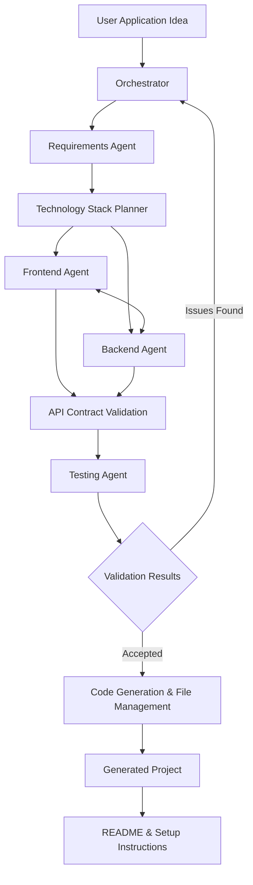

# Multi-Agent AI System for Collaborative Software Development

An AI-powered multi-agent software development system that brings together specialized AI agents to collaboratively plan, design, generate, and validate full-stack applications.

Instead of relying on a single AI model to generate an entire application, this project uses multiple specialized agents that contribute their expertise, discuss implementation decisions, and coordinate through a central orchestrator.

## Project Overview

The Multi-Agent Team is designed to simulate a collaborative software development team consisting of specialized AI developers.

Given a user's application idea and requirements, the system coordinates different agents to analyze the problem, propose an architecture, generate frontend and backend code, and identify potential issues through testing and validation.

**Core philosophy:** Multiple specialized agents collaborating toward one software development goal.

## Architecture

The system is organized around a central orchestrator and specialized agents.



## Specialized Agents

| Agent | Responsibility |
|---|---|
| Orchestrator | Coordinates agents and manages the overall workflow |
| Requirements Agent | Analyzes user requirements and identifies application needs |
| Technology Stack Planner | Helps determine suitable technologies and architecture |
| Frontend Agent | Designs and generates frontend application code |
| Backend Agent | Designs backend architecture, APIs, and business logic |
| Testing Agent | Reviews requirements, identifies edge cases, and validates implementation |
| Code Generation Agent | Coordinates code generation |
| File Manager | Organizes generated project files |

Additional modules support API contract validation, shared schemas, and LLM communication.

## Key Features

- **Multi-Agent Collaboration:** Specialized agents contribute different perspectives to software development.
- **Requirement Analysis:** Converts application ideas into structured development requirements.
- **Technology Stack Planning:** Helps select appropriate technologies for the proposed application.
- **Frontend Generation:** Generates React and TypeScript application code.
- **Backend Generation:** Generates Python backend application code using FastAPI-oriented architecture.
- **API Contract Validation:** Helps maintain consistency between frontend and backend interfaces.
- **Testing and Validation:** Identifies potential implementation issues and missing requirements.
- **Project Generation:** Organizes generated source files into a structured project directory.
- **Documentation:** Generates README and instructions to help developers understand and run generated applications.

## Technology Stack

| Category | Technologies |
|---|---|
| Programming Language | Python |
| AI / LLM Integration | Groq API |
| Frontend | React, TypeScript |
| Styling | Tailwind CSS |
| Backend | FastAPI |
| Data Validation | Python schemas and validation |
| Testing | Pytest |
| Version Control | Git and GitHub |

*The generated application's technology stack can vary depending on the requirements and planning decisions.*

## Project Structure

```text
MultiAgentTeam/
│
├── agent_team/
│   ├── orchestrator.py
│   ├── requirements_agent.py
│   ├── technology_stack_planner.py
│   ├── frontend_agent.py
│   ├── backend_agent.py
│   ├── testing_agent.py
│   ├── code_generation_agent.py
│   ├── api_contractor_validation.py
│   ├── file_manager.py
│   ├── llm_client.py
│   ├── schemas.py
│   ├── workflow_graph.py
│   └── test_*.py
│
├── generated_projects/
│   └── generated_application/
│       ├── frontend/
│       ├── backend/
│       └── README.md
│
├── .env
├── .gitignore
└── README.md
```

## Getting Started

### 1. Clone the Repository

```bash
git clone https://github.com/SREEYUTHA/MULTIAGENT_SYSTEM.git

cd MULTIAGENT_SYSTEM
```

### 2. Create a Virtual Environment

Windows:

```powershell
python -m venv venv
venv\Scripts\activate
```

macOS / Linux:

```bash
python3 -m venv venv
source venv/bin/activate
```

### 3. Install Dependencies

Install the Python dependencies required by the project:

```bash
pip install -r requirements.txt
```

If the dependency file is located elsewhere, use its actual path.

### 4. Configure Environment Variables

Create a `.env` file in the project root.

```env
GROQ_API_KEY=your_groq_api_key
```

Never commit API keys or other credentials to GitHub.

### 5. Run the Application

Start the orchestrator:

```bash
python agent_team/orchestrator.py
```

Follow the execution instructions implemented by the orchestrator.

*The exact startup command and required configuration may evolve as development progresses.*

## Generated Applications

The `generated_projects/` directory stores applications produced by the multi-agent workflow.

Each generated application can contain:

- Frontend source code
- Backend source code
- API implementation
- Tests
- Dependency configuration
- Project documentation

For frontend applications, install dependencies from the generated frontend directory:

```bash
npm install
```

For backend applications, install the dependencies specified in their backend requirements file.

Refer to the generated application's README for its specific execution instructions.

## Testing

The project includes individual test modules for different agents and supporting components.

Run the test suite from the repository root:

```bash
python -m pytest agent_team/ -v
```

## Design Principles

1. **Separation of Responsibilities:** Each agent focuses on a specific development responsibility.
2. **Collaborative Decision-Making:** Agents contribute their perspectives before implementation decisions.
3. **Contract Consistency:** Frontend and backend interfaces should remain aligned.
4. **Validation Before Completion:** Generated outputs should be reviewed and tested.
5. **Modularity:** Agents and supporting components should remain independently maintainable.
6. **Reproducibility:** Generated projects should include the configuration and documentation needed to run them.

## Current Development Status

This project is under active development.

Current focus areas include:

- Improving agent collaboration and orchestration.
- Strengthening structured outputs and schema validation.
- Improving frontend/backend API contract consistency.
- Enhancing testing and error handling.
- Improving generated project quality and reliability.

## Future Enhancements

- More robust inter-agent communication.
- Automated feedback and correction loops.
- Improved code quality evaluation.
- Support for additional programming languages and frameworks.
- Better agent execution monitoring and observability.
- Human-in-the-loop review and approval.
- More comprehensive integration testing.

## Contributing

Contributions, suggestions, and discussions are welcome!

1. Fork the repository.
2. Create a feature branch.
3. Implement your changes.
4. Add or update tests.
5. Submit a pull request describing your contribution.

## Author

**Sreeyutha**

AI & ML Engineer | Python Developer | Generative AI & Multi-Agent Systems

GitHub: [@SREEYUTHA](https://github.com/SREEYUTHA)

---

If you find this project interesting, consider giving the repository a star!

**Built with Python, AI, and collaborative agent engineering.**
